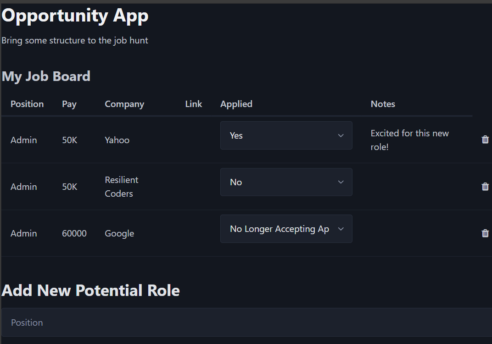

# Opportunity App

## Project Description

Opportunity App is a personal express app that brings structure to the job hunt! Add a role you're intersted in along with the pay and a link to the listing. The notes section is good for missing skills, feelings, or adding the benefits package. Update the status for if you've applied or not. 

### How It's Made:

HTML & CSS – Structure and styling
JavaScript – Front-end and back-end functionality
Node.js – Server-side JavaScript
Express.js – Routes and handling requests
MongoDB – Storing user accounts and saved pins
EJS – Displaying dynamic content
Passport.js – User authentication

## Installation

1. Clone repo
2. run `npm install`

## Usage

1. run `npm run savage`
2. Navigate to `localhost:3000`

## Screenshots and Demo
Live Link: https://opportunityapp-withauth.onrender.com/

### Application Interface

The interface includes your job board with fields for Position, Pay, Company, Link, Applied status, and Notes, and an option to delete. 

